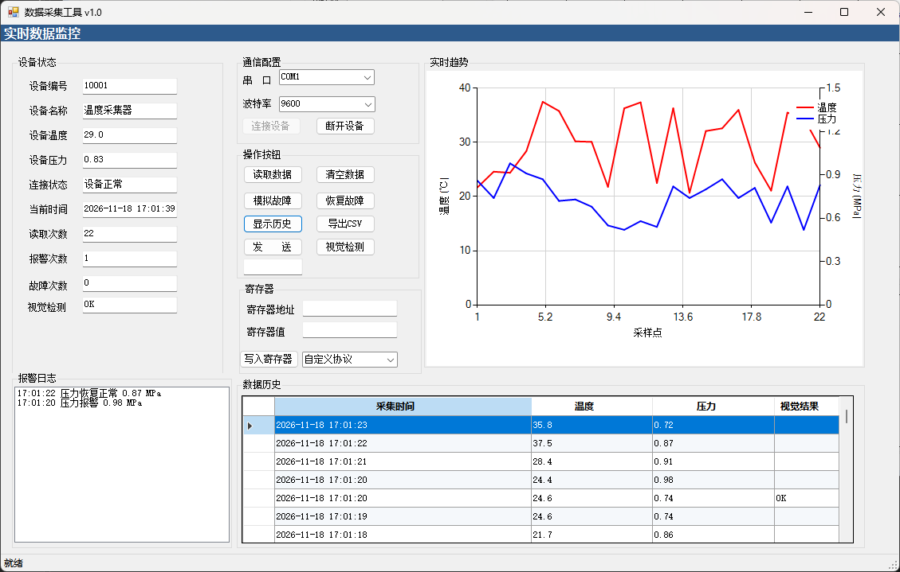

# 串行Modbus上位机（Serial Modbus Upper Machine）

基于 C# WinForms 开发的 Modbus RTU / ASCII 串口采集上位机。项目重点不在于界面本身，而在于演示一套**标准上位机应有的工程化分层**：多线程采集与 UI 解耦、生产者-消费者异步落库、SQLite 并发调优、统一日志与配置抽离，并集成 Halcon 机器视觉检测。

## 界面预览

## 核心功能

- **数据采集**：支持自定义 ASCII 协议和 Modbus RTU 协议，支持无下位机时的模拟数据采集。
- **实时显示**：采集数据实时刷新图表，支持温度、压力双 Y 轴曲线。
- **报警监控**：压力越限边沿触发报警（非持续报警），支持故障模拟与恢复。
- **历史存储**：采集数据自动落库 SQLite，支持查询历史记录与 CSV 导出（含视觉结果列）。
- **机器视觉**：集成 Halcon，通过 RGB 阈值分割检测红色目标（示例为红围巾），结果独立显示并写入历史记录。

## 技术栈

| 项目 | 说明 |
| --- | --- |
| 语言 / 框架 | C# / .NET Framework **4.7.2** / WinForms |
| 通信 | EasyModbusTCP 5.6.0（Modbus RTU）、System.IO.Ports（串口） |
| 存储 | System.Data.SQLite 1.0.119 |
| 图表 | WinForms Chart（双 Y 轴） |
| 机器视觉 | HALCON 26.05 Progress（halcondotnet.dll） |

## 工程化分层

| 文件 | 职责 |
| --- | --- |
| `AppConfig.cs` | 全局配置常量（消灭魔法数字，参数集中管理） |
| `Logger.cs` | 统一日志组件（分级记录异常，输出到 `logs/`，按日期滚动） |
| `DbPath.cs` | 数据库连接工厂（绝对路径 + WAL 并发模式 + 连接池） |
| `DbRecord.cs` | 数据落库实体（轻量 struct，与 UI 解耦，含视觉结果字段） |
| `DeviceData.cs` | 采集数据结构 |
| `VisionHelper.cs` | Halcon 视觉检测封装（读图 → RGB 通道分解 → 阈值分割 → 面积判定） |
| `Form1.cs` | 主窗体（仅负责界面逻辑与业务调度） |

## 关键技术优化

- **UI 无阻塞**：串口轮询在后台线程进行，通过 `BeginInvoke` 安全更新界面（`SafeInvoke` 内含 `IsDisposed` / `IsHandleCreated` / `isClosing` 三重判断）；数据库写入采用生产者-消费者模式（`BlockingCollection` 内存队列 + 后台线程批量事务），高频采集时界面不卡顿。
- **数据可靠性**：开启 `journal_mode=WAL` 与 `busy_timeout=3000`，解决 SQLite 并发读写 `database is locked`；关闭窗口时强制排空写入队列，末尾数据不丢失。
- **异常可追溯**：杜绝空 `catch`，所有异常统一记录到按日期滚动的本地日志文件。
- **视觉与业务解耦**：视觉检测在后台 `Task.Run` 执行，通过 `SafeInvoke` 回写 UI；检测结果作为独立记录入队落库，不干扰正常的采集数据流。

## 环境要求

- Windows 7 及以上（64 位）
- Visual Studio 2019 或 2022（含「.NET 桌面开发」工作负载）
- .NET Framework 4.7.2 运行时
- **HALCON 26.05 Progress**（必需，需有效 License；未安装时项目无法编译）

## 如何运行

1. 用 Visual Studio 打开 **`WindowsFormsApp1.sln`**。
   （若使用 VS 2022 17.14 及以上版本，也可打开 `WindowsFormsApp1.slnx`。）
2. 右键解决方案 → **还原 NuGet 包**。
3. 平台选择 **`x64`**（HALCON 26.05 仅提供 64 位运行时，**不能用 x86 / Any CPU**）。
4. 把 HALCON 安装目录 `bin\x64-win64\` 下的 `halcon.dll` 复制到 `bin\x64\Debug\`，与 exe 同目录（`halcondotnet.dll` 会在编译引用时自动复制）。
5. 无下位机时，点击「读取数据」按钮即可开启模拟采集；点击「视觉检测」按钮运行 Halcon 检测（默认读取 `bin\x64\Debug\test.jpg\frame_000.png`）。
6. 运行时生成的文件：
   - 数据库：`bin/x64/Debug/data/HistoryData.db`
   - 日志：`bin/x64/Debug/logs/`

## 后续规划

- [x] 集成 Halcon 机器视觉检测
- [ ] 视觉检测阈值参数化（改为 `AppConfig` 配置项）
- [ ] 支持多图片批量检测与结果统计
- [ ] 引入配置文件（appsettings.json），支持运行时修改参数而无需重新编译。
- [ ] 引入依赖注入，进一步解耦通信层与界面层。
- [ ] 支持 OPC UA 协议接入。
- [ ] 补充单元测试（协议解析、报警边沿判定）。
